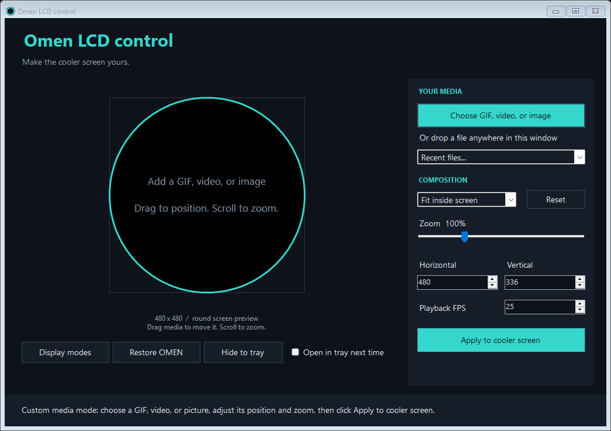
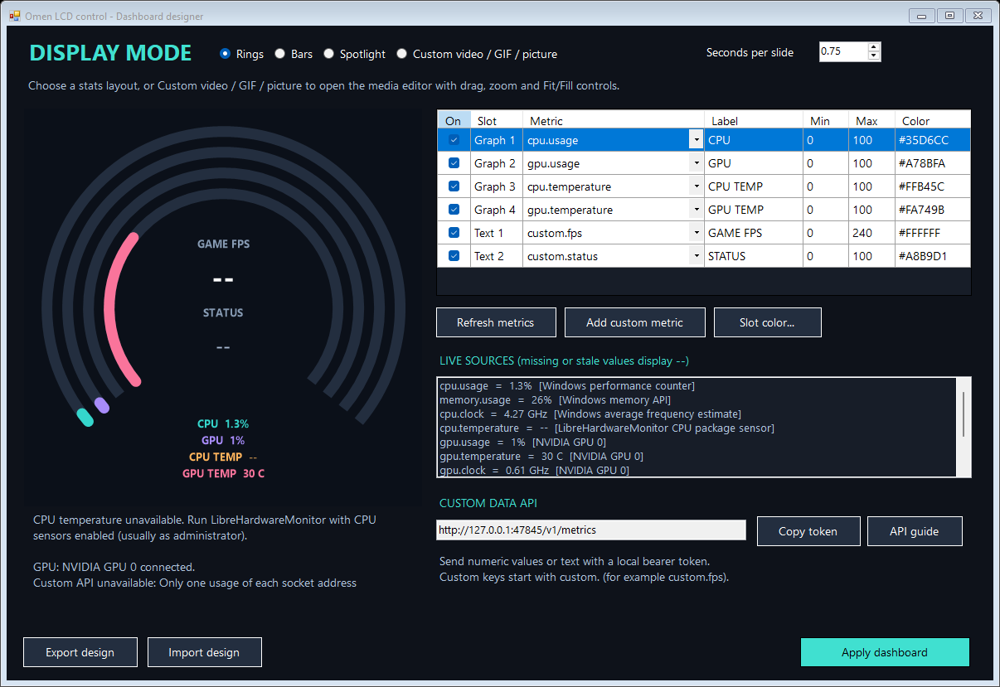

# Omen LCD control

A community Windows app for putting your own GIFs, videos, and images on a compatible HP OMEN cooler LCD.





## Get started

Run `OmenLCDControl.exe` from the portable release folder. No installation or administrator account is required in the tested configuration.

If you still have the earlier PowerShell controller open, restore and close it before using this app.

1. Click **Display modes** to choose **Rings**, **Bars**, **Spotlight**, or **Custom video / GIF / picture**. The fourth option opens the media editor. Click **Choose GIF, video, or image**, or drop a file into the editor.
2. Drag it inside the round preview. Scroll or use the slider to resize it. Fit and Fill provide starting layouts; horizontal and vertical controls allow precise positioning.
3. Click **Apply to cooler screen**. Conversion runs in the background and can be cancelled before the display settings change.
4. Close the window or click **Hide to tray** to keep it running. Double-click the teal ring in the Windows system tray to reopen it.
5. Right-click the tray icon and choose **Restore and exit** to restore your previous OMEN settings and quit.

GIF previews animate. Video previews show a poster frame; the full video loops on the hardware after applying. The square output is 480 × 480, with its corners hidden by the round LCD.

**Display modes** presents all four options together: Rings, Bars, Spotlight (one metric per slide, 0.5–1 second), and Custom video / GIF / picture. For stats, assign six slots, set colors and graph ranges, disable fields, and import/export designs. CPU/RAM usage, CPU speed, GPU usage/temperature/clock/VRAM, local time, and custom numeric/text data are available. CPU temperature requires a running LibreHardwareMonitor sensor provider. NVIDIA GPU metrics use the installed NVIDIA tools.

Custom media supports animated GIFs, videos (MP4, MKV, AVI, MOV, WebM), and still pictures (JPG, PNG, BMP). Drag and zoom, use Fit/Fill, then **Apply to cooler screen**. Selecting an option alone does not replace current playback; the selected media or stats take over when you click its Apply button. Return to **Display modes** whenever you want to switch back to stats.

Read [the dashboard guide](docs/dashboards.md) and [custom data API guide](docs/custom-data.md). Game FPS and other custom values must be supplied by your own telemetry integration. The API runs on loopback with a bearer token while Stats studio or a dashboard session is active. Closing the windows keeps it running in the tray.

## Requirements and compatibility

- Windows 10/11, x64, with .NET Framework 4.8.
- HP's installed `OMENLCDDisplayHelper.exe`, its bundled FFmpeg, and initialized LCD settings. Open OMEN Gaming Hub's LCD Display page at least once if these are missing.
- Tested on an **OMEN MAX 45L GT23-0xxx**. Other models with the same helper may work, but have not been verified.

Keep OMEN Gaming Hub's window closed while using this app. Changes from Gaming Hub or profile switching can replace the app's selection. This is a community project, independent of HP, and relies on undocumented settings that HP updates may change.

## Background behavior and recovery

Closing the editor hides it in the tray. It does not stop playback. **Open in tray next time** remembers whether to show the editor on launch. To start at Windows login, create a shortcut to `OmenLCDControl.exe --tray` in your Windows Startup folder; the app does not install startup entries automatically.

Before the first Apply in a session, the app saves your two original HP display configuration files. Repeated Apply operations keep those original backups. **Restore OMEN** or **Restore and exit** restores the original files, including their exact bytes. Restoration also returns any HP settings you changed during the app session to their backed-up values.

After an interruption, reopening the app offers recovery through **Restore OMEN**. Saved state lives in `%LOCALAPPDATA%\OmenScreen`:

The folder keeps its original name for upgrade compatibility, so existing preferences, recovery backups and custom API senders continue working. Exit the old version before launching the renamed app. The executable is now `OmenLCDControl.exe`.

| Folder/file | Purpose |
| --- | --- |
| `preferences.json` | Last media, composition, recent files, and tray preference |
| `recovery/` | Original HP settings and active-session marker |
| `cache/` | Converted media and live stats frame |
| `app.log` | Local error details, capped at about 1 MB |
| `api-token.txt` | Private bearer token for the local custom metrics API |

Keep `recovery/` intact during a custom-display session. Conversion cache is retained in this early release; after restoring and exiting you can remove `cache/` to reclaim space. Your source files are never modified. Media and file paths stay on your PC. The custom API accepts local connections only; the app makes no external network requests and includes no telemetry.

## How it controls the display

HP's LCD helper already supports Image and Video modes during normal operation. Omen LCD control sets the selected media path and mode in `globallcdsettings.json` and `profilelcdsettings.json`, then restarts only HP's LCD helper. It preserves unrecognized JSON fields. GIFs are converted to silent MP4s using HP's bundled FFmpeg; still images use Windows drawing APIs.

It does not flash firmware, patch HP binaries, replace drivers, or change pump/fan settings. No HP binaries are redistributed. See [the backend notes](docs/backend.md) for the configuration contract and limitations.

## Build and test

From Windows PowerShell in this folder:

```powershell
.\build.ps1 -Test
```

The script builds `dist/OmenLCDControl.exe` with the Windows .NET Framework compiler, then runs isolated tests. The project also opens in Visual Studio via `OmenLCDControl.csproj`. There are no NuGet dependencies.

To build tested portable and source release ZIPs, run `./package.ps1`. Packages appear in `release/` and include the guides and examples. See [the release guide](docs/releasing.md) for GitHub setup and tagged releases.

Media integration tests require HP's installed FFmpeg:

```powershell
.\tests\integration.ps1
```

Explicit hardware validation briefly changes the screen and restores the settings in a `finally` block:

```powershell
.\tests\integration.ps1 -Hardware
.\tests\dashboard-integration.ps1 -Hardware
```

Unit checks cover composition geometry, actual still-image pixels, unknown JSON field preservation, repeated Apply backups, exact restoration, restart-failure rollback, and rejection of missing profiles. Integration checks cover animated GIF preview frames and transformed 480 × 480 video output. Hardware validation confirmed changing frames in HP's output and exact restoration; physical appearance of the new editor's composition still merits user testing.

## Project status

Version **0.3.2**, early community prototype. The portable executable is unsigned. The app has been tested on one PC, rather than across the OMEN product range.

Dashboard validation covers numeric/text ingestion, stale readings, protected system metrics, authenticated HTTP, graph ranges, all three renderers and slide advancement. Live Windows/NVIDIA readings and changing source frames were checked on the test PC, with exact HP configuration restoration. This HP transport does not expose refreshed Image-mode output files, so physical LCD updates still need user verification. The Image-mode timer runs approximately twice per second; fast Spotlight transitions will be less smooth than the preview.

Good next improvements: direct FPS provider integrations, multi-GPU selection, smoother hardware transport, animated video preview, an installer, a cache manager, and broader Windows/DPI testing. See [CONTRIBUTING.md](CONTRIBUTING.md) for useful bug report details.

Released under the [MIT license](LICENSE). This license covers the project code, not HP's separately installed software.
