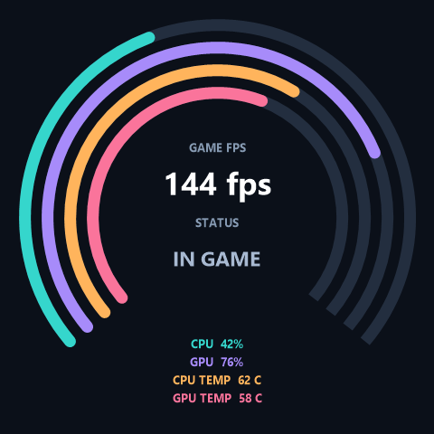

# Design a stats screen

Open **Display modes**, choose a stats layout, assign metrics, and click **Apply dashboard**. The fourth option, **Custom video / GIF / picture**, opens the media editor, where you can choose a file, drag/zoom, use Fit/Fill, and click **Apply to cooler screen**. Close the designer and editor to continue in the tray. Applying a media file replaces the dashboard. Return to Display modes to switch back to stats. Restore OMEN returns the saved HP settings.

* **Rings:** four concentric gauges with matching legends, plus two center fields.
* **Bars:** four horizontal gauges, plus two footer fields.
* **Spotlight:** one enabled slot at a time, with a large value and gauge. All six enabled slots participate; choose 0.50–1.00 seconds per slide.

The screenshots show illustrative values. Each slot has an enable switch, metric, label, color and numeric minimum/maximum. For example, CPU load is 0–100, temperature might be 20–100, clock speed 0–6 GHz, and game FPS 0–240. Ranges affect graph fill, not the displayed number. Values beyond the range clamp at an empty/full graph. Text fields have no fill. Disable slots you do not need. Export/import JSON designs to share presets without your API token or readings.

The designer animates at approximately 10 frames per second. HP's Image mode polls the live JPEG at approximately 2 frames per second on the tested machine, so the physical Spotlight transition can be less smooth and the timing less exact than the preview. A 1-second interval is a more reliable starting point. Sensors update roughly once a second; LibreHardwareMonitor is checked every two seconds when connected. Missing/stale values show `--`.

| Metric ID | Units / source |
| --- | --- |
| `cpu.usage` | %, Windows total processor performance counter |
| `memory.usage` | %, Windows physical memory load |
| `cpu.clock` | GHz, Windows average frequency estimate; mean core clocks when LibreHardwareMonitor is connected |
| `cpu.temperature` | C, LibreHardwareMonitor CPU package/Tctl, otherwise highest CPU temperature sensor |
| `gpu.usage` | %, NVIDIA GPU 0; LibreHardwareMonitor core load fallback |
| `gpu.temperature` | C, NVIDIA GPU 0; LibreHardwareMonitor core temperature fallback |
| `gpu.clock` | GHz, NVIDIA GPU 0; LibreHardwareMonitor core clock fallback |
| `gpu.memory` | %, NVIDIA GPU 0 used/total VRAM |
| `system.time` | Local clock text |
| `custom.*` | Your numeric or text data through the [local API](custom-data.md) |

NVIDIA uses the installed `nvidia-smi.exe`. GPU 0 is the first NVIDIA GPU; multi-GPU selection is not implemented. Other GPU vendors require LibreHardwareMonitor. Windows CPU clock is an estimate and can differ from instantaneous per-core boost speeds.

For CPU temperature, download and run [LibreHardwareMonitor](https://github.com/LibreHardwareMonitor/LibreHardwareMonitor/releases), enable CPU sensors, and leave it running. It often needs administrator privileges to read hardware sensors; Omen LCD control itself can stay unelevated. The integration reads the monitor's `root\LibreHardwareMonitor` WMI namespace. Sensor availability depends on the hardware and monitor version. The app does not substitute an ACPI motherboard temperature for CPU temperature.

Source references: [NVIDIA System Management Interface](https://docs.nvidia.com/deploy/nvidia-smi/index.html), [LibreHardwareMonitor WMI example](https://github.com/LibreHardwareMonitor/LibreHardwareMonitor/blob/master/LibreHardwareMonitor.Windows.Forms/TestScripts/basicwmi.py), [Windows performance counters](https://learn.microsoft.com/en-us/windows/win32/perfctrs/collecting-performance-data).
